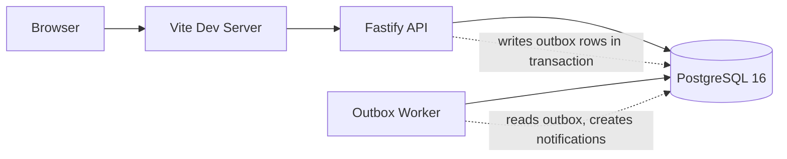

# WorkTracker

Internal operations work-item tracker for managing requests, incidents, and approvals across multiple teams.

## Setup

```bash
docker compose up -d
npm install
npm run db:migrate
npm run db:seed
npm run dev
```

The app runs at http://localhost:5173 (frontend) with the API at http://localhost:3000.

## Demo Accounts

All passwords: `password123`

| Role | Email |
|------|-------|
| Superadmin / Engineering lead | alice@example.com |
| Operations lead | bob@example.com |
| Customer Support lead | carol@example.com |
| Infrastructure lead | dan@example.com |
| Engineering admin | eve@example.com |
| Members | ivy@example.com through zara@example.com |

## Running Tests

Tests run against a separate Postgres instance on port 5433 (defined in docker-compose.yml as `postgres-test`).

```bash
docker compose up -d
npm run test
```

## Project Layout

```
server/
  src/
    index.ts            - Fastify server entry point
    worker.ts           - Outbox worker process
    workflow.ts         - Status transition table
    auth/
      authorize.ts      - authorize() function, membership checks
    middleware/
      auth-hook.ts      - JWT cookie auth
      error-handler.ts  - Consistent error responses
      idempotency.ts    - Idempotency key middleware
    routes/
      auth.ts           - Login, logout, /me
      work-items.ts     - CRUD, claim, transition, assign, approve
      comments.ts       - Comment list and create
      events.ts         - Event history
      notifications.ts  - Notification list and mark-read
      teams.ts          - Team list and members
      dashboard.ts      - Dashboard aggregation queries
    db/
      pool.ts           - pg Pool, query, transaction helpers
      migrate.ts        - Migration runner
      seed.ts           - Seed script (30 users, 4 teams, 20k items)
      migrations/       - SQL migration files
    test/
      helpers.ts        - Test database setup, factories
      api.test.ts       - Integration tests
web/
  src/
    main.tsx            - React entry, QueryClient, Router
    App.tsx             - Route configuration
    api.ts              - API client with idempotency keys
    auth.tsx            - Auth context
    pages/
      Login.tsx
      Layout.tsx        - Sidebar, notifications
      Dashboard.tsx
      WorkItemList.tsx   - Filters, search, pagination
      WorkItemDetail.tsx - Edit, claim, transitions, timeline
      WorkItemCreate.tsx
```

## Architecture



The server writes business changes and outbox events in the same database transaction. A separate worker process polls the outbox with `SELECT ... FOR UPDATE SKIP LOCKED` and creates notifications with idempotent inserts (dedupe_key). No external message broker needed.

## Documentation & Deliverables

- **[ENGINEERING_DECISIONS.md](./ENGINEERING_DECISIONS.md)** — Key architectural choices and trade-offs (optimistic concurrency, transactional outbox, authorization & 404 isolation, keyset pagination + FTS, append-only audit events, and deliberate omissions).
- **[KNOWN_LIMITATIONS.md](./KNOWN_LIMITATIONS.md)** — Current trade-offs, edge cases, and production scaling considerations.
- **[DEFENSE_NOTES.md](./DEFENSE_NOTES.md)** — Detailed request flows, failure modes, 10x scaling plan, and walkthrough notes.
- **[server/src/test/api.test.ts](./server/src/test/api.test.ts)** — 33 integration tests covering concurrency, idempotency, state machine transitions, authorization, outbox worker, pagination, search/filtering, notifications, dashboard, teams, and authentication.

